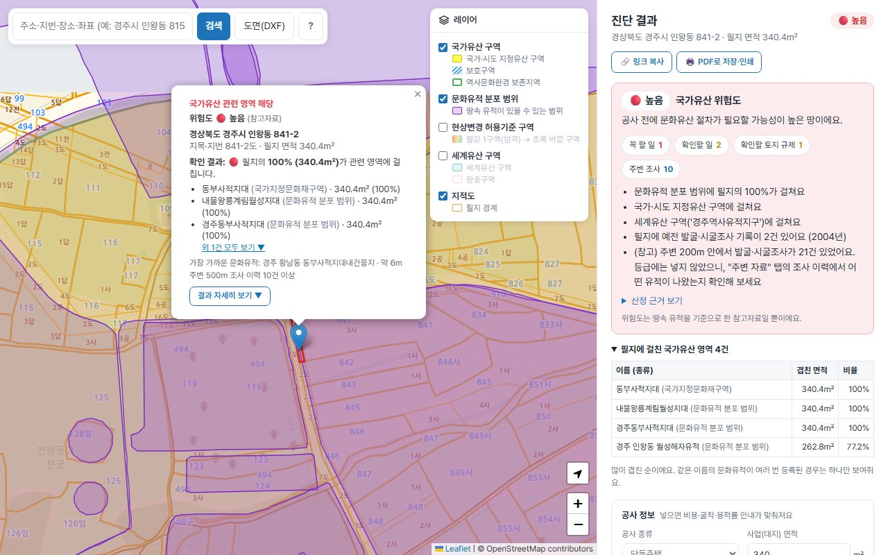

# 땅파기전

> 땅을 파기 전에, 내 땅에 문화유산 관련 절차가 필요한지 지도에서 바로 확인하는 서비스

👉 **https://before-digging.vercel.app**

토지에서 건설공사를 하려면 그 땅이 매장유산 유존지역이나 국가유산 구역에 해당하는지 먼저 알아야 해요. 해당되면 국가유산영향진단, 발굴조사, 허가 같은 절차가 생기고 공사 일정과 비용이 크게 달라져요. 그런데 이 정보는 여러 기관 사이트에 흩어져 있고 법령 용어도 어려워요.

땅파기전은 지도에서 필지를 누르면 여러 공공데이터를 한 번에 조회해서, **해당 여부와 다음에 해야 할 일**을 쉬운 말로 알려줘요.



사용법은 [사용설명서](docs/사용설명서.md)에 그림과 함께 정리했어요. 사이트에서는 검색창 옆 **?** 버튼으로 볼 수 있어요.

## 주요 기능

- **사용설명서**: 사이트 안 도움말(검색창 옆 ?)과 그림이 있는 [문서](docs/사용설명서.md)
- **지도 앱 화면**: 지도가 화면 전체에 나오고, PC는 오른쪽 사이드바, 휴대폰은 아래에서 끌어올리는 시트로 결과를 봄. 결과는 맨 위 요약(위험도와 꼭 할 일·토지 규제·주변 조사 개수)과 탭(국가유산 / 토지 규제 / 주변 자료 / 문의)으로 나눔. 레이어 켜기와 범례는 '레이어' 메뉴 하나에
- **필지 단위 진단**: 누른 필지가 국가유산 구역, 문화유적 분포 범위와 얼마나 겹치는지(㎡, %) 계산. 지도 팝업에는 많이 겹친 3건만, 결과 패널에는 걸친 영역 전체를 표로 보여줌
- **위험도 등급**: 높음 / 주의 / 낮음 / 확인 불가. 해당하는 이유와 산정 기준을 화면에서 공개. 천연기념물·철새도래지 같은 자연유산 구역은 등급에서 빼고 따로 안내
- **해야 할 일 안내**: 국가유산영향진단, 약식영향진단 대상 여부를 법령 근거와 함께 안내
- **현상변경 허용기준**: 필지에 걸친 허용기준 구역(1구역, 2-1구역 등)과 그 구역의 높이 기준·공통 기준을 보여주고, 기준 안이면 약식영향진단 생략 가능 안내. 지도에서 구역 레이어를 켜서 볼 수 있음
- **세계유산 확인**: 고시된 세계유산지구면 세계유산영향평가 대상 안내, 등재 구역·완충구역이면 확인 안내, 500m 안에 세계유산 구역이 있으면 거리와 영향평가 요청 가능성 안내 (예: 종묘 앞 세운4구역)
- **비용 안내**: 조사 비용 부담 주체, 공사 종류와 면적에 따른 발굴비용 지원 대상 여부
- **주변 정보**: 500m 안의 문화유적 분포 범위까지 거리, 발굴·시굴·지표조사 이력. 지표조사로 확인된 유적은 같은 범위에서 그 뒤에 한 표본·시굴·발굴조사 기록을 함께 보여줌. 발굴·시굴조사는 국가유산청 보고서 목록으로 바로 검색, 필지가 있는 동·리의 발굴조사 허가 현황 링크. 조사기관 전화번호·홈페이지 안내(한국문화유산협회 회원기관)
- **도면(DXF)으로 사업부지 진단**: DXF를 올리면 닫힌 경계선을 사업부지로 읽고, 좌표계(중부·동부원점 등)를 주소와 함께 보여줘 고르게 함. 부지 전체 진단(위험도·해야 할 일, 면적으로 3만㎡ 판단)과 걸친 필지별 위험도 표(CSV 내려받기). 도면은 브라우저에서만 읽고 경계 좌표만 서버로 보냄
- **다른 토지 규제 쉬운 안내**: 토지이음에 나오는 토지이용계획 중 공사에 큰 영향을 주는 것(개발제한구역, 농업진흥구역, 보전산지, 상수원보호구역, 군사시설 보호구역, 자연공원, 하천구역, 도시계획도로, 지구단위계획구역 등)을 쉬운 말과 법령 근거로 풀어 보여줌. 용도지역은 건폐율·용적률 상한과 땅 면적으로 계산한 예시, 지목이 농지·임야면 전용 허가 안내. 나머지 규제는 이름만 접어서 표시. 국가유산 위험도와는 따로 보여줌
- **주소·좌표 검색**: 지번(예: 경주시 인왕동 815-1), 도로명, 장소 이름. 좌표 숫자 두 개를 넣으면 좌표계(중부·동부원점, UTM-K, 경위도 등)마다 위치를 주소와 함께 보여주고 고르게 함
- **문의처**: 관할 시·군·구와 문화유산 담당 부서 이름을 바로 보여줌(예: 종로구청 문화유산과). 이름에 '문화유산'이 들어간 부서가 없는 곳은 문화 업무 부서를 추정으로 표시하고 확인 안내. 전화번호는 자료에 없어 검색 링크와 110 안내
- **굴착 깊이**: 지반 해발과 굴착 깊이를 넣으면 굴착 바닥 해발을 계산. 도면(DXF)을 올리면 부지 안 표고점 글자나 등고선 높이를 읽어 지반 해발을 자동으로 채우고, 주변 300m 안 시추공의 지반 고도를 참고값으로 보여줌
- **자료 자동 갱신**: 파일로 넣어 둔 공공데이터(시추공, 조사기관 연락처, 담당 부서)를 매달 새로 받아 바뀌었을 때만 저장
- **결과 공유·PDF 저장**: "링크 복사"로 진단한 위치와 공사 종류·면적 입력을 담은 링크를 보내면, 받은 사람이 열 때 같은 필지를 바로 진단(휴대폰은 공유 창). "PDF로 저장·인쇄"는 지도·버튼을 빼고 결과만 펼친 상태로 출력하고, 진단 일시와 다시 보기 링크를 머리에 넣음. 도면 사업부지 결과는 PDF와 CSV로 공유
- **법령 개정 자동 확인**: 매주 관련 법령의 개정 여부를 확인해 바뀌면 GitHub 이슈로 알림
- **외부 데이터 장애 자동 점검**: 매일 오전 8시에 VWorld·국가유산청 데이터 10곳을 자료가 확실한 위치(경복궁, 종묘, 경주 월성)로 불러 보고, 두 번 연속 실패하거나 결과가 비면 GitHub 이슈로 알림. 복구되면 이슈를 자동으로 닫음

> 모든 결과는 공공데이터와 법령을 바탕으로 한 **참고자료**이며 법적 판단을 대신하지 않습니다. 정확한 내용은 관할 시·군·구 문화유산 담당 부서나 국가유산청에 문의하세요.

## 사용한 공공데이터

| 데이터 | 제공 |
|---|---|
| 연속지적도, 국가유산 지정/보호구역, 토지이용계획, 주소 검색 | 국토교통부 브이월드 |
| 문화유적분포지도, 국가유산조사구역 | 국가유산청 국가유산 공간정보서비스 |
| 법령 개정 정보 | 법제처 국가법령정보 공동활용 |
| 배경지도 | OpenStreetMap |

## 기술 구조

```
브라우저 (React + TypeScript, Leaflet)
   │
   ├─ /api/parcel          필지 진단: 지적도 + 국가유산 구역 + 문화유적 + 조사구역, 겹친 면적·거리 계산 + 토지이용계획
   ├─ /api/heritage        지적도에 없는 곳의 지점 진단
   ├─ /api/heritage-sites  문화유적 분포 범위 도형 (줌 15 타일 단위)
   ├─ /api/search          주소·장소 검색
   ├─ /api/vworld          지적도·국가유산 구역 지도 이미지 (API 키를 숨기는 프록시)
   ├─ /api/law-versions    법령 시행 정보 (GitHub Actions가 매주 호출)
   └─ /api/health          외부 데이터 장애 점검 (GitHub Actions가 매일 호출)
         │
   Vercel 서버리스 함수 (서울 리전)
```

- **화면**: [React](https://react.dev/) + TypeScript, [Vite](https://vite.dev/), 지도는 [Leaflet](https://leafletjs.com/)
  - 기능별 폴더: `src/map/`(지도·레이어·범례·핀 팝업), `src/search/`(검색창·좌표 입력), `src/result/`(결과 패널·안내 규칙·공유 링크·담당 부서), `src/site/`(도면 사업부지·DXF 읽기), `src/shared/`(사이드바·하단 시트, 같이 쓰는 함수·서버 응답 타입)
- **서버 폴더**: `api/`의 파일 하나가 주소 하나(`/api/parcel` 등), 여러 주소가 같이 쓰는 부품은 `api/_lib/`
- **서버**: Vercel 서버리스 함수(Node.js). VWorld와 법령 API가 해외 접속을 막아서 서울 리전(`icn1`)에 고정
- **도형 계산**: [Turf.js](https://turfjs.org/)
- **자동화**: GitHub Actions (`.github/workflows/law-watch.yml`)
- **안내 규칙**: 해야 할 일, 비용, 위험도 등급 규칙은 `src/result/guidance.js` 한 파일에 모음. 다른 토지 규제의 쉬운 말 안내는 `src/result/land-rules.ts` (도면 읽기 규칙은 `src/site/dxf-site.js`)

## 직접 실행하기

```bash
npm install
npm run dev             # 화면만 실행, /api는 배포된 서버(before-digging.vercel.app)로 보냄
```

API까지 내 컴퓨터에서 돌리려면:

```bash
cp .env.example .env    # VWORLD_API_KEY, LAW_API_OC 입력
npx vercel dev
```

- `VWORLD_API_KEY`: [브이월드](https://www.vworld.kr) 오픈API 인증키
- `LAW_API_OC`: [국가법령정보 공동활용](https://open.law.go.kr) 인증값 (법령 개정 확인에만 필요)
- 배포 방법은 [docs/VERCEL_DEPLOY.md](docs/VERCEL_DEPLOY.md)를 참고하세요.

## 문서

- [사용설명서](docs/사용설명서.md): 땅 찾기, 결과 읽기(위험도·탭), 도면(DXF) 진단, 레이어, 공유·PDF, 휴대폰, 자주 묻는 질문
- [기획서](docs/기획서.md): 문제 정의, 대상 사용자, 진행 단계, 데이터 한계, 법·제도 근거, 위험도 기준

## 업데이트 기록

### 2026-10-12
- 사용설명서: 사이트 안 도움말(검색창 옆 ? 버튼, 처음 화면의 "사용설명서 보기")과 화면 그림이 들어간 `docs/사용설명서.md`. 팝업이 검색창에 가리지 않게 지도 이동 여백 추가, 탭 구조에 맞게 "아래 주변 조사 이력" 같은 문구를 "주변 자료 탭"으로 고침, 검색창 안내 문구 줄임
- 디자인 1차: 지도를 화면 전체로 넓히고 결과를 PC 사이드바·휴대폰 하단 시트로 옮김. 결과 패널을 요약 카드 + 탭(국가유산 / 토지 규제 / 주변 자료 / 문의)으로 나눠 길게 내려 읽지 않아도 되게 함. 범례와 레이어 메뉴를 하나로 합침, 처음 화면에 사용 안내, 색·글꼴(Pretendard) 정리. 인쇄·PDF는 탭을 모두 펼쳐서 출력
- 다른 토지 규제 쉬운 안내: 결과 패널에 "다른 토지 규제"를 추가. VWorld 토지이용계획(토지이음과 같은 자료)에서 개발제한구역·농업진흥구역·보전산지·상수원보호구역·군사시설 보호구역·자연공원·하천구역·도시계획도로 등 공사에 큰 영향을 주는 규제를 쉬운 말과 법령 근거로 안내하고, 용도지역의 건폐율·용적률 상한, 농지·임야 전용 허가도 안내. 지도 팝업에는 공사를 크게 막는 규제만 한 줄로. 도면 사업부지는 필지마다 조회해 걸친 필지 수와 함께 표시. 장애 점검과 법령 개정 확인 대상에도 추가

### 2026-10-11
- 사용 불편 개선: 필지를 누르면 결과 패널에도 "확인하는 중"과 지난 시간을 표시(실패하면 패널에도 안내), 도면 사업부지 진단도 기다리는 동안 지난 시간과 무엇을 하는 중인지 표시, 검색 결과 목록은 지도 등 바깥을 누르거나 Esc로 닫힘, 브라우저 탭 아이콘(favicon) 추가
- 코드 단순화: 서버 함수 8곳에 반복되던 요청 방식 확인·VWorld 키 확인·좌표 범위 확인을 `api/_lib/http.js` 하나로 모음. 화면도 서버 요청·좌표 후보 주소 찾기·우리나라 범위 확인을 `src/shared/api.ts`로 모으고, 진단·검색을 async/await로 정리. 동작은 그대로
- 파일을 기능별 폴더로 정리: 화면은 지도·검색·결과·도면·공용(`src/map`, `search`, `result`, `site`, `shared`), 서버 공용 부품은 `api/_lib/`, 배포 안내는 `docs/`로. 결과 패널 파일 이름을 `ResultPanel`·`ResultSections`로 바꿈. 동작은 그대로

### 2026-10-10
- 화면을 React + TypeScript(Vite)로 전환: 2,000줄짜리 `index.html`을 컴포넌트로 나눔. 안내 규칙·도면 읽기 규칙과 `api/`는 그대로, 기능·화면도 전환 전과 같음. 도면 라이브러리는 CDN 대신 npm으로 넣고 쓸 때만 받음
- 주변 시추공 참고값: 국토교통부 지반정보 시추공 32만 곳을 `data/boreholes.bin.gz`로 넣고, 결과 화면에 300m 안 가까운 5곳의 지반 고도와 "가장 가까운 시추공 고도 넣기" 버튼
- 자료 자동 갱신 워크플로(`.github/workflows/data-update.yml`): 매달 시추공·조사기관 자료 갱신, 1월·7월 담당 부서 갱신 알림
- 담당 부서 자료도 자동 갱신: 기관코드 사이트가 조회 화면의 쿠키와 Referer가 있어야 전체자료를 내줌을 확인, 스크립트가 직접 받아 zip을 풀어 처리 (1월·7월 알림 이슈는 없앰)
- 자동 갱신 첫 실행에서 조사기관 목록만 실패: 협회 사이트가 중간 인증서를 빼고 보내서 리눅스에서 접속 거부 → 인증서의 AIA 주소로 빠진 인증서를 받아 신뢰 루트로 이어지는지 확인한 뒤 붙임. 모두 성공하면 실패 이슈 자동으로 닫기
- 좌표계 추가([SGIS 좌표계 코드](https://sgis.mods.go.kr/developer/html/openApi/api/dataCode/CoordCode.html) 기준): 경위도(WGS84·베셀), 구글 메르카토르를 도면 좌표계 후보에 넣고, 검색창 좌표 입력 추가
- 굴착 깊이: 지반 해발·굴착 깊이 입력 → 굴착 바닥 해발 계산. DXF의 표고점 글자(표고·EL·GL 레이어 등)·점·등고선 높이를 읽어 부지 안 중간값으로 지반 해발을 채움. 테스트 도면에 표고점·등고선 추가
- 위험도 기준 2차 조정(실무 의견): 주변 200m 안 발굴·시굴조사 3건 이상 → 주의 기준을 빼고 참고 안내로 바꿈. 역사문화환경 보존지역은 주의 그대로, "설계 전에 현상변경 허가 대상인지 확인" 안내 추가
- 문의처에 시·군·구 문화유산 담당 부서 이름 표시: 행정표준코드 기관코드 전체자료에서 `scripts/update-departments.mjs`로 `data/departments.json` 생성 (230곳 중 확실 32, 추정 189, 못 찾음 9). 2026년 전남·광주 통합 등 시·도 이름 차이 맞춤
- 지도 팝업의 "외 N건"을 누르면 결과 패널의 걸친 영역 전체 표로 이동 (경복궁처럼 걸친 유적이 많은 필지에서 나머지를 볼 곳이 없었음)
- 진단 결과 공유: 링크 복사(위치·공사 종류·면적을 주소에 담아 열면 다시 진단, 서버에 저장하지 않음), PDF로 저장·인쇄(결과 패널만, 펼쳐보기 모두 펼침, 진단 일시·링크 표시)
- 외부 데이터 장애 자동 점검: `/api/health`가 VWorld(지적도·국가유산 구역·지도 이미지·검색)와 국가유산청(문화유적·조사구역·허용기준 구역과 내용·세계유산) 9곳을 확인, `.github/workflows/health-check.yml`이 매일 실행해 장애면 이슈 생성·복구되면 닫기
- VWorld 데이터 오류 메시지에 오류 코드(예: INCORRECT_KEY)를 함께 남김

### 2026-10-09
- 도면(DXF)으로 사업부지 진단: 경계 레이어·좌표계 고르기(후보마다 주소 표시), 부지 전체 진단 + 필지별 표, CSV 내려받기. 테스트용 도면 `samples/test-gyeongju-5187.dxf`
- 서버 진단 로직을 경계 하나를 진단하는 공용 모듈(`api/_analyze.js`)로 정리 (필지 진단 결과는 이전과 같음)
- 위험도 기준 조정: 지표조사 확인 유적은 높음 → 주의 (보고서 의견에 따라 조사 여부가 달라지므로), 자연유산 구역(철새도래지 등)은 등급과 유존지역 판단에서 빼고 현상변경 허가 안내만 표시
- 지표조사 확인 유적에 그 뒤 같은 범위의 표본·시굴·발굴조사 기록 연결, 지표조사 구역의 유적 유무(있음/없음) 안내
- "문의처" 추가: 필지 주소로 관할 시·군·구를 보여주고 문화유산 담당 부서 찾기(검색 링크)와 정부민원안내콜센터 110 안내
- 위험도: 현상변경 허용기준의 개별검토·심의 구역을 주의로 올리고, 안내에 "확인 필요" 문구(허가 대상 여부를 미리 문의) 추가
- 세계유산 구역·완충구역·세계유산지구 확인과 세계유산영향평가 안내, 지도 레이어 추가 (세계유산법 시행령 2026.3.31. 개정 반영)
- 현상변경 허용기준: 필지에 걸친 구역과 구역별 높이 기준·공통 기준 안내, 지도 레이어 추가 (국가유산공간정보서비스)
- 조사 이력에 조사기관 연락처 안내 (한국문화유산협회 회원기관 목록, 옛 이름 "문화재연구원"도 맞춤)
- 조사 이력에 "보고서 찾기"(국가유산청 발굴조사 보고서 목록 검색)와 동·리별 발굴조사 허가 현황 링크 추가

### 2026-10-08
- 별도 저장소로 Vercel 배포 연결, 서버 함수를 서울 리전으로 고정 (VWorld 해외 접속 차단 대응)
- 지적도를 줌 17 이상에서 표시 (VWorld가 그보다 멀리서는 빈 이미지를 보냄)
- 임시 GeoJSON을 실제 공공데이터로 교체: VWorld 국가유산 지정/보호구역, 국가유산청 문화유적분포지도
- 지도 범례, 내 위치 버튼(누를 때만 위치 권한 요청), 지도 핀 하나만 유지
- 필지 단위 진단: 필지와 각 구역이 겹친 면적·비율 계산
- 해야 할 일·비용 안내 (국가유산영향진단법, 매장유산법, 문화유산법 조문 확인)
- 관련 법령 개정 자동 확인 (매주 월요일, GitHub Actions)
- 주변 문화유적 거리, 주변 조사 이력(발굴·시굴·지표조사)
- 주소 검색을 VWorld 검색으로 교체 (지번 검색 지원)
- 기본 반응형, 모바일 사용성 조정 (범례 접기, 터치 화면 +/- 숨김)
- 위험도 등급 (규칙 방식, 산정 근거 공개)
- README, 기획서 작성

### 2026-10-04 이전
- 지도, 주소 검색, 현재 위치, 임시 위험구역 판별, VWorld 지적도 프록시 (첫 버전)
