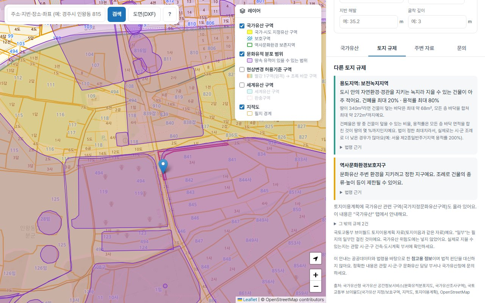
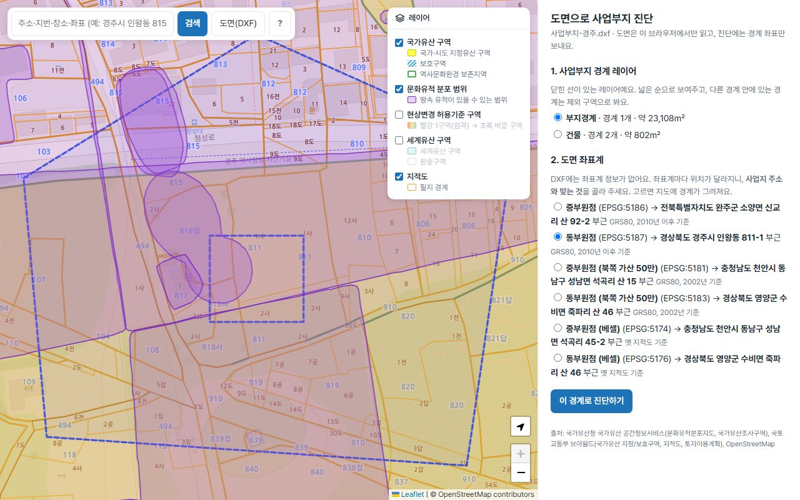
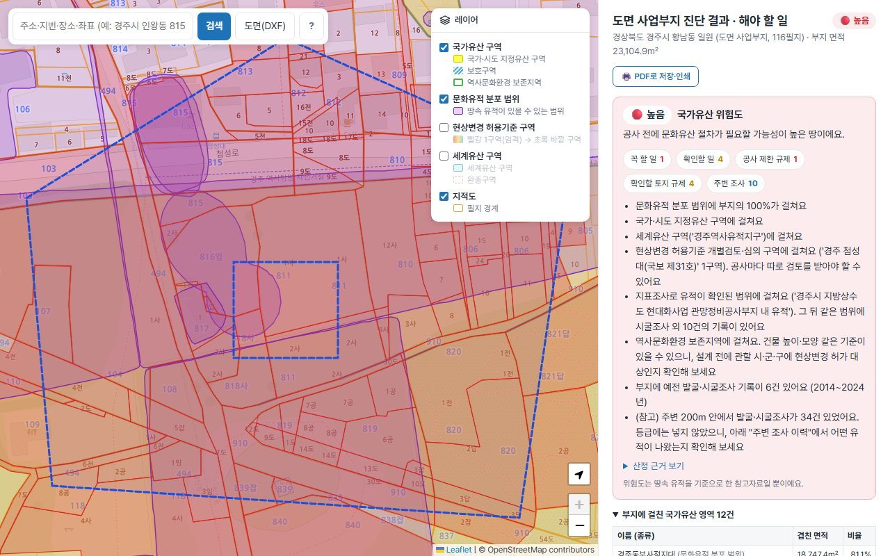
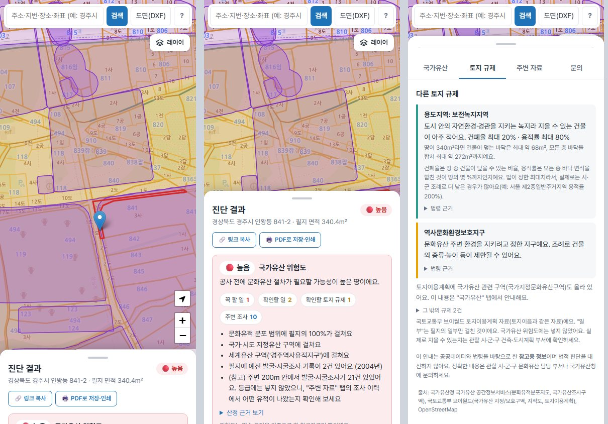
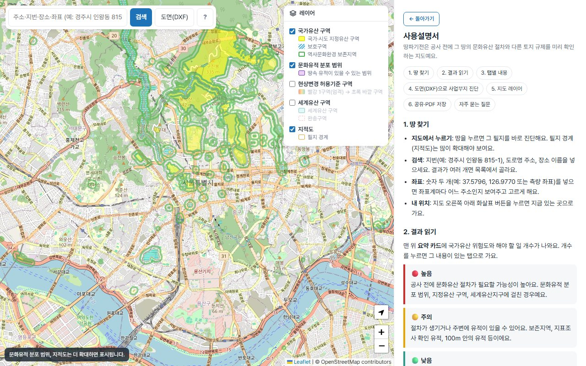

# 땅파기전 사용설명서

땅파기전은 공사 전에 그 땅의 **문화유산 절차**와 **다른 토지 규제**를 미리 확인하는 지도 서비스예요.

- 서비스: https://before-digging.vercel.app
- 사이트에서는 검색창 옆 **?** 버튼으로 같은 내용(그림 빼고)을 볼 수 있어요.

> 모든 결과는 공공데이터와 법령을 바탕으로 한 **참고자료**이며 법적 판단을 대신하지 않아요. 설계 전에 관할 시·군·구 담당 부서에 꼭 확인하세요.

## 목차
1. [땅 찾기](#1-땅-찾기)
2. [결과 읽기](#2-결과-읽기)
3. [탭별 내용](#3-탭별-내용)
4. [도면(DXF)으로 사업부지 진단](#4-도면dxf으로-사업부지-진단)
5. [지도 레이어](#5-지도-레이어)
6. [공유·PDF 저장](#6-공유pdf-저장)
7. [휴대폰에서 쓰기](#7-휴대폰에서-쓰기)
8. [자주 묻는 질문](#8-자주-묻는-질문)

---

## 1. 땅 찾기

| 방법 | 설명 |
|---|---|
| 지도에서 누르기 | 땅을 누르면 그 필지를 바로 진단해요. 필지 경계(지적도)는 많이 확대해야 보여요. |
| 검색 | 지번(예: 경주시 인왕동 815-1), 도로명 주소, 장소 이름. 결과가 여러 개면 목록에서 골라요. |
| 좌표 | 숫자 두 개(예: `37.5796, 126.9770` 또는 측량 좌표)를 넣으면 좌표계마다 어느 주소인지 보여주고 고르게 해요. |
| 내 위치 | 지도 오른쪽 아래 화살표 버튼. |

## 2. 결과 읽기

필지를 누르면 지도에 요약 팝업이, 오른쪽(휴대폰은 아래)에 결과가 나와요.

### 요약 카드
맨 위에 **국가유산 위험도**와 해야 할 일의 개수가 나와요. "꼭 할 일 1", "확인할 토지 규제 1" 같은 개수를 누르면 그 내용이 있는 탭으로 가요.

| 위험도 | 뜻 | 대표적인 경우 |
|---|---|---|
| 🔴 높음 | 공사 전에 문화유산 절차가 필요할 가능성이 높음 | 문화유적 분포 범위, 지정유산 구역, 세계유산지구에 걸침 |
| 🟡 주의 | 절차가 생기거나 주변에 유적이 있을 수 있음 | 역사문화환경 보존지역, 지표조사 확인 유적, 100m 안의 유적, 필지의 예전 발굴 기록 |
| 🟢 낮음 | 확인한 자료에서는 근거가 없음 | 위에 하나도 해당하지 않음 |
| ⚪ 확인 불가 | 자료 일부를 불러오지 못함 | 잠시 후 다시 진단 |

정확한 기준은 결과의 **산정 근거 보기**에 모두 나와요. 위험도는 **땅속 유적** 기준이라 그린벨트 같은 토지 규제는 넣지 않아요.

### 공사 정보
넣으면 안내가 맞춰져요.
- **공사 종류·면적**: 발굴비용 지원 대상인지, 3만㎡ 이상이라 국가유산영향진단 대상인지 알려줘요. 면적은 필지 면적이 먼저 들어가 있어요.
- **지반 해발·굴착 깊이**: 굴착 바닥이 해발 몇 m인지 계산해요. 지반 해발을 모르면 주변 시추공 고도를 참고로 넣을 수 있어요.

## 3. 탭별 내용

| 탭 | 내용 |
|---|---|
| 국가유산 | 해야 할 일(영향진단·허가·신고 등)과 법령 근거, 굴착 깊이, 비용, 알아두세요 |
| 토지 규제 | 용도지역(건폐율·용적률 상한과 면적 예시), 개발제한구역·농업진흥구역·보전산지·상수원보호구역·군사시설 보호구역 등을 쉬운 말로. 지목이 농지·임야면 전용 허가 안내 |
| 주변 자료 | 500m 안 문화유적과 예전 발굴·시굴·지표조사 기록, 보고서 찾기, 조사기관 연락처 |
| 문의 | 관할 시·군·구 문화유산 담당 부서 이름과 전화번호 찾기 |

안내 카드 왼쪽 띠 색은 **빨강 = 꼭 해야 하거나 공사를 크게 막는 것**, **노랑 = 확인이 필요한 것**, **초록 = 참고**예요.

## 4. 도면(DXF)으로 사업부지 진단

사업부지가 여러 필지에 걸치면 검색창 옆 **도면(DXF)** 으로 한 번에 진단해요. 도면 파일은 브라우저에서만 읽고 서버에는 경계 좌표만 보내요.

1. 사업부지 경계를 **닫힌 폴리라인**으로 그린 DXF를 고르세요. 다른 경계 안에 있는 경계는 제외 구역으로 봐요.
2. 경계가 있는 **레이어**를 고르세요.
3. **좌표계**를 고르세요. DXF에는 좌표계 정보가 없어서, 후보마다 그렇게 읽으면 어느 주소인지 보여줘요. 실제 사업부지 주소와 같은 것을 고르면 지도에 경계가 그려져요.
4. **이 경계로 진단하기**를 누르면 부지 전체 결과와 필지별 표가 나와요.

- 지도의 필지는 위험도 색으로 칠해지고, 필지나 표의 줄을 누르면 그 필지 결과를 봐요.
- 필지별 표는 CSV로 내려받을 수 있어요.
- 도면에 표고 글자나 등고선이 있으면 지반 해발을 자동으로 읽어요.
- 부지는 2㎢, 300필지까지예요. 필지가 많으면 1분 가까이 걸려요.

## 5. 지도 레이어

지도 오른쪽 위 **레이어** 메뉴에서 켜고 끄고, 색이 무엇을 뜻하는지 볼 수 있어요.

| 레이어 | 처음 상태 | 비고 |
|---|---|---|
| 국가유산 구역 | 켜짐 | 지정유산 구역(노랑), 보호구역(파란 빗금), 역사문화환경 보존지역(초록 테두리) |
| 문화유적 분포 범위 | 켜짐 | 보라색. 많이 확대해야 보여요 |
| 현상변경 허용기준 구역 | 꺼짐 | 빨강 1구역(엄격) → 초록 바깥 구역 |
| 세계유산 구역 | 꺼짐 | 구역·완충구역 |
| 지적도 | 켜짐 | 필지 경계. 많이 확대해야 보여요 |

## 6. 공유·PDF 저장

- **링크 복사**: 위치와 입력한 공사 정보가 담긴 링크예요. 받은 사람이 열면 **그때의 자료로 다시 진단**해서, 자료가 바뀌었으면 결과도 달라요. 휴대폰에서는 공유 창(카카오톡, 문자 등)이 떠요.
- **PDF로 저장·인쇄**: 지금 결과를 탭까지 모두 펼쳐서 진단 일시, 다시 보기 링크와 함께 남겨요. 그 순간의 결과를 보관하려면 PDF를 쓰세요.
- 도면 사업부지 결과는 링크 대신 PDF와 CSV로 공유해요.

## 7. 휴대폰에서 쓰기

결과는 아래에서 올라오는 창에 나와요. 손잡이(회색 막대)를 **끌어올리거나 누르면** 접힘 → 반쯤 → 전체로 바뀌어요. 접혀 있어도 제목 줄에서 위험도를 볼 수 있어요. 레이어 메뉴는 접힌 채로 시작해요.

## 8. 자주 묻는 질문

**"낮음"이면 문화유산 조사를 안 해도 되나요?**
확인한 공공자료에 근거가 없다는 뜻이에요. 자료에 없는 유적이 있을 수 있고, 공사 중 유물이 나오면 공사를 멈추고 신고해야 해요. 3만㎡ 이상 공사는 위험도와 관계없이 국가유산영향진단 대상이에요.

**위험도와 토지 규제는 무슨 관계인가요?**
따로예요. 위험도는 땅속 문화유산만 봐요. 그린벨트나 농업진흥구역은 "토지 규제" 탭에서 따로 확인하세요.

**토지이음이나 다른 사이트와 결과가 달라요.**
국가유산청·국토교통부 자료를 받아 오는데, 기관마다 갱신 시점이 달라서 차이가 날 수 있어요. 지적도와 구역도의 도면 오차로 경계에만 살짝 걸치는 경우는 "경계에만 걸침"으로 따로 표시해요.

**도면 좌표계를 모르겠어요.**
후보마다 나오는 주소를 보고 실제 사업부지 주소와 같은 것을 고르면 돼요. 측량 도면은 대부분 중부원점(서울·경기·충청·전라 등)이나 동부원점(경상도 등)이에요.

**결과를 그대로 믿어도 되나요?**
공공데이터와 법령을 바탕으로 한 참고자료예요. 설계 전에 "문의" 탭의 관할 시·군·구 담당 부서에 꼭 확인하세요.

